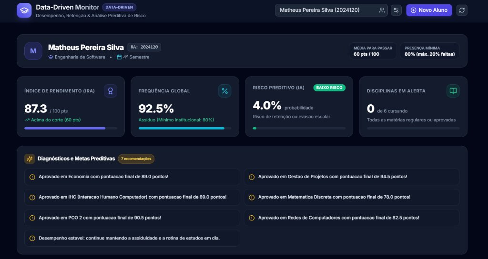

# Sistema Pessoal de Monitoramento de Desempenho, Retenção e Risco Acadêmico (Data-Driven)

Aplicação web orientada a dados (*Data-Driven*) para acompanhamento individual de rendimento universitário, controle de assiduidade e análise preditiva de risco de reprovação ou evasão escolar, calibrada segundo as regras de avaliação acadêmica institucional.

---

## 1. Visão Geral e Regras Institucionais

Diferente de painéis administrativos genéricos baseados em massas de dados fictícias (*mock/seed*), esta plataforma opera a partir dos dados reais fornecidos pelo próprio estudante.

O sistema foi modelado para refletir a régua acadêmica da instituição de ensino superior (FANS - Faculdade de Nova Serrana), adotando o regime semestral dividido em 3 etapas avaliativas, totalizando 100 pontos por componente curricular:

- **1ª Etapa (máximo 25 pontos):** 15 pontos de avaliação formal + 5 pontos de atividades em sala + 5 pontos de trabalho interdisciplinar.
- **2ª Etapa (máximo 30 pontos):** 15 pontos de avaliação formal + 10 pontos de trabalho interdisciplinar + 5 pontos de atividades em sala.
- **3ª Etapa (máximo 45 pontos):** 25 pontos de avaliação formal + 10 pontos de atividades em sala + 10 pontos de Prova F (interdisciplinar).
- **Critério de Aprovação por Nota:** Acúmulo de no mínimo 60 pontos na soma das três etapas.
- **Critério de Aprovação por Frequência:** Mínimo de 80% de assiduidade (máximo de 20% de faltas sobre a carga horária semestral — ex.: limite de 16 faltas para 80h e 8 faltas para 40h).

A cada inserção ou atualização de registro, o backend recalcula os indicadores no MongoDB e consome o serviço preditivo em Python para emitir diagnósticos imediatos de retenção e metas para as etapas pendentes.

---

## 2. Demonstração Visual do Sistema

| Visão Geral do Dashboard | Tabela de Desempenho por Disciplina |
| :---: | :---: |
|  |  |
| *KPIs globais, diagnóstico preditivo da IA e recomendações* | *Notas por etapa (/25, /30, /45), total (/100) e consumo de faltas* |

| Cadastro de Estudante | Lançamento de Componente Curricular |
| :---: | :---: |
|  |  |
| *Parametrização institucional (60 pts / 80% presença)* | *Composição das 3 etapas com simulação em tempo real* |

---

## 3. Stack Tecnológica

| Camada | Tecnologias Principais | Descrição |
| :--- | :--- | :--- |
| **Backend REST & Batch** | Java 25, Spring Boot 4 (`4.0.0-M1`), Spring Batch, Gradle 9.3.1 | Exposição de endpoints RESTful, validação com Jakarta Bean Validation e ingestão em lote de CSV. |
| **Motor Preditivo (IA)** | Python 3.13, FastAPI, Uvicorn, Pydantic v2, Pytest | Processamento probabilístico de risco acadêmico via modelo logístico (`logistic-academic-risk-v2-fans`). |
| **Frontend Web** | React 18, TypeScript, Vite 6, Tailwind CSS, Recharts, Lucide React | Interface responsiva (*Single Page Application*), visualização analítica em gráficos e simulação dinâmica. |
| **Banco de Dados** | MongoDB (Replica Set / MongoDB Atlas) | Armazenamento de documentos nas coleções `alunos`, `disciplinas_desempenho` e `analises_preditivas`. |

---

## 4. Arquitetura e Estrutura de Diretórios

```text
dashboard_data_driven/
├── images/                             # Capturas de tela da aplicacao
│   ├── dashboard_overview.jpg
│   ├── disciplinas_table.jpg
│   ├── modal_cadastro_aluno.png
│   └── modal_lancamento_disciplina.png
│
├── frontend/                           # Interface Web SPA (React + TypeScript + Vite)
│   ├── src/
│   │   ├── components/                 # Componentes visuais (Tabela, Modais, Cards, Graficos)
│   │   ├── services/                   # Comunicacao HTTP com o Backend
│   │   ├── types/                      # Interfaces e DTOs TypeScript
│   │   ├── App.tsx                     # Gestao do estado do painel
│   │   └── main.tsx                    # Ponto de entrada React
│   ├── package.json
│   └── vite.config.ts
│
├── predictive-service/                 # Microservico Preditivo (Python + FastAPI)
│   ├── tests/                          # Suite de testes automatizados com pytest
│   │   └── test_predict.py
│   ├── main.py                         # Rotas /health e /api/v1/predict
│   ├── predictor.py                    # Motor logistico e geracao de recomendacoes
│   ├── requirements.txt
│   └── schemas.py                      # Validacao de contratos via Pydantic
│
├── src/                                # Backend Principal (Java + Spring Boot)
│   ├── main/
│   │   ├── java/com/academic/dashboard/
│   │   │   ├── RetentionDashboardApplication.java
│   │   │   ├── batch/                  # Leitores, processadores e gravadores Spring Batch
│   │   │   ├── config/                 # Configuracao de CORS e infraestrutura
│   │   │   ├── controller/             # Controladores RESTful (/api/v1/*)
│   │   │   ├── dto/                    # Objetos de transferencia de dados
│   │   │   ├── exception/              # GlobalExceptionHandler e excecoes de dominio
│   │   │   ├── mapper/                 # Conversores Entidade <-> DTO
│   │   │   ├── model/                  # Entidades NoSQL e Enums de situacao
│   │   │   ├── repository/             # Interfaces Spring Data MongoDB
│   │   │   ├── service/                # Regras de negocio, calculos e analise
│   │   │   └── validation/             # Sanitizacao e seguranca contra injeções
│   │   └── resources/
│   │       └── application.properties
│   └── test/                           # Testes automatizados JUnit 5
│
├── build.gradle
├── gradlew
├── gradlew.bat
└── README.md
```

---

## 5. Modelagem de Dados (MongoDB)

### 5.1. Coleção `alunos`
Armazena os parâmetros acadêmicos do discente.

| Campo | Tipo | Descrição |
| :--- | :--- | :--- |
| `id` | `String` | Identificador único (`ObjectId`). |
| `nome` | `String` | Nome completo do estudante. |
| `matricula` | `String` | Registro acadêmico do aluno (índice único). |
| `curso` | `String` | Nome do curso de graduação. |
| `semestreAtual` | `Integer` | Período acadêmico em curso (`1` a `20`). |
| `mediaMinimaAprovacao` | `Double` | Pontuação de corte para aprovação direta (`60.0`). |
| `frequenciaMinimaExigida` | `Double` | Percentual mínimo de presença exigido (`80.0%`). |

### 5.2. Coleção `disciplinas_desempenho`
Armazena as avaliações por etapa, faltas e indicadores calculados.

| Campo | Tipo | Descrição |
| :--- | :--- | :--- |
| `id` | `String` | Identificador único (`ObjectId`). |
| `alunoId` | `String` | Referência indexada ao aluno. |
| `nomeDisciplina` | `String` | Nome do componente curricular. |
| `semestreLetivo` | `String` | Período letivo (ex.: `2026.1`). |
| `totalAulasSemestre` | `Integer` | Carga horária total da disciplina em número de aulas. |
| `quantidadeFaltas` | `Integer` | Total de ausências acumuladas no semestre. |
| `percentualFrequencia` | `Double` | Percentual de presença calculado (`0.0%` a `100.0%`). |
| `notaEtapa1` | `Double` | Pontuação obtida na 1ª Etapa (`0.0` a `25.0`). |
| `notaEtapa2` | `Double` | Pontuação obtida na 2ª Etapa (`0.0` a `30.0`). |
| `notaEtapa3` | `Double` | Pontuação obtida na 3ª Etapa (`0.0` a `45.0`). |
| `mediaAtual` | `Double` | Total de pontos acumulados (`0.0` a `100.0`). |
| `notaNecessariaParaPassar` | `Double` | Pontos faltantes para alcançar a meta de aprovação. |
| `faltasRestantesPermitidas` | `Integer` | Margem de faltas disponíveis antes de atingir 20% de ausências. |
| `statusSituacao` | `StatusSituacao` | `APROVADO`, `REGULAR`, `ATENCAO_NOTA`, `ATENCAO_FALTA`, `RISCO_CRITICO`, `REPROVADO`. |

### 5.3. Coleção `analises_preditivas`
Consolidação analítica do perfil estudantil recalculada a cada evento de escrita.

| Campo | Tipo | Descrição |
| :--- | :--- | :--- |
| `id` | `String` | Identificador único (`ObjectId`). |
| `alunoId` | `String` | Referência indexada ao estudante (`unique`). |
| `dataAtualizacao` | `LocalDateTime` | Data e hora do último processamento analítico. |
| `indiceRendimentoAcademico` | `Double` | IRA global ponderado (média cumulativa de pontos). |
| `frequenciaGlobal` | `Double` | Taxa média de assiduidade ponderada pela carga horária. |
| `scoreRiscoEvasaoReprovacao` | `Double` | Score probabilístico de retenção estimado pela IA (`0.0%` a `100.0%`). |
| `classificacaoRisco` | `ClassificacaoRisco` | Categoria de risco: `BAIXO`, `MODERADO`, `ALTO` ou `CRITICO`. |
| `alertasPreditivos` | `List<String>` | Lista consolidada de avisos normativos e diagnósticos preditivos. |

---

## 6. Contratos da API REST (`/api/v1`)

| Método | Rota | Descrição | Resposta de Sucesso |
| :--- | :--- | :--- | :--- |
| `POST` | `/api/v1/alunos` | Cadastra estudante e inicializa a análise preditiva | `201 Created` |
| `GET` | `/api/v1/alunos` | Lista todos os estudantes cadastrados | `200 OK` |
| `GET` | `/api/v1/alunos/{id}` | Retorna os dados cadastrais do estudante | `200 OK` |
| `PUT` | `/api/v1/alunos/{id}` | Atualiza perfil e recalcula todo o histórico vinculado | `200 OK` |
| `DELETE` | `/api/v1/alunos/{id}` | Remove o estudante, suas disciplinas e análise preditiva | `204 No Content` |
| `GET` | `/api/v1/alunos/{id}/dashboard` | Retorna o dashboard consolidado (`DashboardPerformanceDTO`) | `200 OK` |
| `POST` | `/api/v1/disciplinas` | Registra nova disciplina e devolve o dashboard atualizado | `201 Created` |
| `PUT` | `/api/v1/disciplinas/{id}` | Atualiza notas parciais ou faltas e devolve o dashboard | `200 OK` |
| `GET` | `/api/v1/disciplinas/{id}` | Consulta detalhes de uma disciplina específica | `200 OK` |
| `GET` | `/api/v1/disciplinas/aluno/{id}` | Lista disciplinas com filtros opcionais de semestre e status | `200 OK` |
| `DELETE` | `/api/v1/disciplinas/{id}` | Remove disciplina e devolve o dashboard recalculado | `200 OK` |
| `POST` | `/api/v1/importacoes/boletim/{id}` | Processa arquivo CSV em lote via Spring Batch | `200 OK` |

### Formato do Arquivo para Importação CSV em Lote
```csv
nomeDisciplina,semestreLetivo,totalAulasSemestre,quantidadeFaltas,notaEtapa1,notaEtapa2,notaEtapa3
POO 2,2026.1,80,6,23.5,28.0,39.0
Redes de Computadores,2026.1,80,8,21.0,25.5,36.0
Economia,2026.1,40,2,22.0,27.0,40.0
Matematica Discreta,2026.1,80,10,19.5,22.0,
```

---

## 7. Validações de Segurança e Integridade

- **Defesa contra NoSQL Injection:** Identificadores e parâmetros de busca são submetidos a validação de padrão regex seguro via `InputSecurityValidator`, rejeitando operadores NoSQL maliciosos antes da consulta ao banco de dados.
- **Defesa contra CSV/Formula Injection:** O leitor de lote sanitiza registros removendo caracteres que induzem execução de fórmulas (`=`, `+`, `-`, `@`).
- **Validação de Invariantes de Negócio:**
  - O número de faltas não pode exceder o total de aulas da disciplina.
  - Bloqueio de duplicidade para componentes curriculares com mesmo nome no mesmo semestre letivo para um mesmo estudante.
  - As notas submetidas devem respeitar os limites de cada etapa avaliativa.
- **Respostas de Erro Uniformes:** Exceções tratadas centralizadamente via `GlobalExceptionHandler` (`@RestControllerAdvice`), garantindo respostas limpas sem exposição de detalhes internos de implementação.

---

## 8. Guia de Execução Local

### 8.1. Pré-Requisitos
- Java JDK 25 instalado
- Python 3.13 com pip
- Node.js 20+ com npm
- MongoDB em execução local (`mongodb://localhost:27017`) ou URI do MongoDB Atlas

---

### 8.2. Inicialização dos Serviços

#### 1. Microsserviço Preditivo (Python / FastAPI)
```bash
cd predictive-service
python -m venv .venv

# Ativacao do ambiente virtual (Windows: .venv\Scripts\activate | Linux/macOS: source .venv/bin/activate)
.venv\Scripts\activate

pip install -r requirements.txt
pytest tests
python -m uvicorn main:app --port 8000 --host 127.0.0.1
```
*Disponível em: `http://127.0.0.1:8000` (Swagger: `/docs`).*

#### 2. Backend Principal (Java / Spring Boot)
Na raiz do repositório:
```bash
# Definir connection string (opcional se rodando MongoDB local na porta 27017)
export MONGODB_URI="mongodb+srv://<usuario>:<senha>@cluster.mongodb.net/retention_dashboard_db?retryWrites=true&w=majority"

# Execucao no Windows (PowerShell):
# $env:MONGODB_URI="sua_connection_string"; .\gradlew.bat bootRun

./gradlew test
./gradlew bootRun
```
*Disponível em: `http://localhost:8080`.*

#### 3. Interface Web (React / Vite)
No diretório `frontend`:
```bash
cd frontend
npm install
npm run build
npm run dev
```
*Disponível no navegador em: `http://localhost:5173`.*

---

## 9. Estratégia de Branches e Versionamento

O repositório segue o padrão *GitFlow* com convenções de *Conventional Commits*:
- **`main`:** Versão de produção, estável e homologada.
- **`develop`:** Branch ativa de integração para desenvolvimento contínuo.
- **Prefixos de Commit:** `feat:`, `fix:`, `refactor:`, `test:`, `docs:`.
