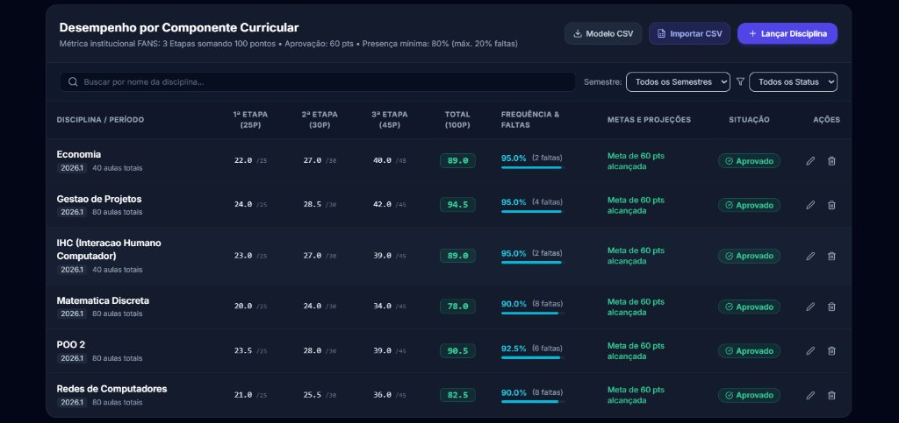
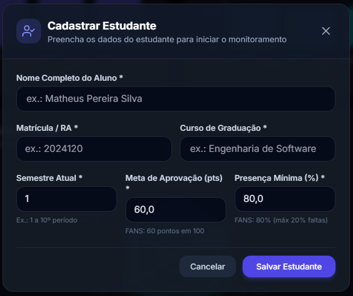
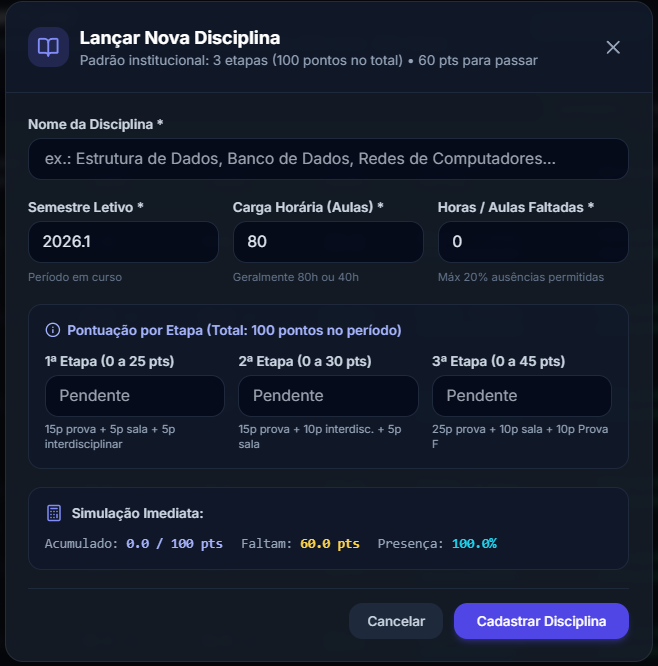

# Sistema Pessoal de Monitoramento de Desempenho, Retenção e Risco Acadêmico (Data-Driven)

Aplicação web orientada a dados (*Data-Driven*) para acompanhamento individual de rendimento universitário, controle de assiduidade e análise preditiva de risco de reprovação ou evasão escolar, calibrada segundo as regras de avaliação acadêmica institucional.

---

## 1. Visão Geral

Diferente de painéis administrativos genéricos ou sistemas baseados em massas de dados fictícias (*mock/seed*), esta plataforma opera a partir dos dados reais fornecidos pelo próprio estudante.

O sistema foi modelado para refletir a régua acadêmica da instituição de ensino superior (FANS - Faculdade de Nova Serrana), adotando o regime semestral dividido em 3 etapas avaliativas, totalizando 100 pontos por componente curricular:

- **1ª Etapa (máximo 25 pontos):** 15 pontos de avaliação formal + 5 pontos de atividades em sala + 5 pontos de trabalho interdisciplinar.
- **2ª Etapa (máximo 30 pontos):** 15 pontos de avaliação formal + 10 pontos de trabalho interdisciplinar + 5 pontos de atividades em sala.
- **3ª Etapa (máximo 45 pontos):** 25 pontos de avaliação formal + 10 pontos de atividades em sala + 10 pontos de Prova F (interdisciplinar).
- **Critério de Aprovação por Nota:** Acúmulo de no mínimo 60 pontos (60/100) na soma das três etapas.
- **Critério de Aprovação por Frequência:** Mínimo de 80% de assiduidade (máximo de 20% de ausências permitidas sobre a carga horária semestral — ex.: limite de 16 faltas para disciplinas de 80h e 8 faltas para disciplinas de 40h).

A cada inserção, alteração ou exclusão de registro acadêmico, o backend persiste as informações no **MongoDB**, executa o motor analítico em **Java** e o microsserviço preditivo em **Python (FastAPI)**, atualizando o painel em tempo real.

---

## 2. Demonstração Visual do Sistema

### 2.1. Visão Geral do Dashboard e Diagnóstico Preditivo
Painel principal consolidando indicadores-chave de desempenho (IRA, Frequência Global, Risco Preditivo e Disciplinas em Alerta), acompanhado das recomendações automáticas do motor de inteligência artificial.


### 2.2. Acompanhamento por Componente Curricular
Tabela interativa com detalhamento da pontuação obtida em cada etapa (1ª, 2ª e 3ª), total acumulado, percentual de frequência com barra de consumo do limite de faltas, projeção de pontos faltantes para a meta de 60 pontos e situação acadêmica.



### 2.3. Cadastro e Ajuste de Critérios Institucionais
Interface para parametrização do estudante, curso, período letivo, meta de aprovação institucional (padrão: 60 pontos) e percentual mínimo de presença exigido (padrão: 80%).



### 2.4. Lançamento e Simulação de Disciplinas
Formulário de cadastro e atualização de notas e faltas com simulação imediata de acúmulo de pontos e projeção da nota necessária nas etapas restantes.



---

## 3. Stack Tecnológica

### Backend (REST API e Batch)
- **Linguagem:** Java 25 (LTS)
- **Framework Principal:** Spring Boot 4 (`4.0.0-M1`)
- **Módulos Spring:**
  - `spring-boot-starter-web`: Exposição de serviços RESTful e suporte a multipart upload.
  - `spring-boot-starter-data-mongodb`: Persistência NoSQL com mapeamento de documentos e gestão de índices.
  - `spring-boot-starter-validation`: Validação declarativa via Jakarta Bean Validation.
  - `spring-boot-starter-batch`: Processamento em lote de históricos e boletins CSV.
- **Build Tool:** Gradle 9.3.1 (via Gradle Wrapper).

### Microsserviço Preditivo (Machine Learning / IA)
- **Linguagem:** Python 3.13
- **Framework Web:** FastAPI e Servidor Uvicorn
- **Validação de Contratos:** Pydantic v2
- **Modelo:** Algoritmo logístico calibrado para risco acadêmico (`logistic-academic-risk-v2-fans`)
- **Testes Automatizados:** Pytest e HTTPX / FastAPI TestClient

### Frontend (Interface Web SPA)
- **Biblioteca Base:** React 18 com TypeScript
- **Ferramenta de Build:** Vite 6
- **Estilização:** Tailwind CSS e PostCSS
- **Visualização de Dados e Gráficos:** Recharts (gráficos de barras, radar multidimensional e linhas de referência)
- **Ícones:** Lucide React

### Banco de Dados
- **MongoDB:** Instância NoSQL configurável localmente ou via MongoDB Atlas (Replica Set).

---

## 4. Arquitetura e Estrutura de Diretórios

O projeto está estruturado em arquitetura modular com separação clara de responsabilidades entre cliente, serviço preditivo e backend corporativo:

```text
dashboard_data_driven/
├── images/                             # Capturas de tela para documentacao
│   ├── dashboard_overview.jpg
│   ├── disciplinas_table.jpg
│   ├── modal_cadastro_aluno.png
│   └── modal_lancamento_disciplina.png
│
├── frontend/                           # Interface Web SPA (React + TypeScript + Vite)
│   ├── src/
│   │   ├── components/                 # Componentes visuais (Tabelas, Modais, Cards, Graficos)
│   │   │   ├── AlertasBanner.tsx
│   │   │   ├── AlunoModal.tsx
│   │   │   ├── ChartsSection.tsx
│   │   │   ├── CsvImportModal.tsx
│   │   │   ├── DisciplinaModal.tsx
│   │   │   ├── DisciplinasTable.tsx
│   │   │   ├── EmptyState.tsx
│   │   │   ├── KpiCards.tsx
│   │   │   ├── Navbar.tsx
│   │   │   └── Toast.tsx
│   │   ├── services/                   # Cliente HTTP e comunicacao com a API
│   │   │   └── api.ts
│   │   ├── types/                      # Contratos TypeScript (DTOs, Enums, Interfaces)
│   │   │   └── api.ts
│   │   ├── App.tsx                     # Orquestracao do estado global do painel
│   │   ├── index.css                   # Configuracoes de layout e design glassmorphism
│   │   └── main.tsx                    # Ponto de entrada da aplicacao React
│   ├── package.json
│   ├── tailwind.config.js
│   ├── tsconfig.json
│   └── vite.config.ts
│
├── predictive-service/                 # Microservico Preditivo (Python + FastAPI)
│   ├── tests/                          # Testes unitarios automatizados da IA
│   │   └── test_predict.py
│   ├── main.py                         # Endpoints /health e /api/v1/predict
│   ├── predictor.py                    # Motor probabilistico logistico e recomendacoes
│   ├── requirements.txt                # Dependencias do servico Python
│   └── schemas.py                      # Schemas de validacao Pydantic
│
├── src/                                # Backend Principal (Java + Spring Boot)
│   ├── main/
│   │   ├── java/com/academic/dashboard/
│   │   │   ├── RetentionDashboardApplication.java
│   │   │   ├── batch/                  # Configuracoes, Leitores e Processadores Spring Batch
│   │   │   │   ├── dto/DisciplinaCsvRow.java
│   │   │   │   ├── BatchConfig.java
│   │   │   │   ├── BatchImportService.java
│   │   │   │   ├── CsvReaderConfig.java
│   │   │   │   ├── DisciplinaItemProcessor.java
│   │   │   │   └── DisciplinaItemWriter.java
│   │   │   ├── config/                 # Configuracao de CORS e Beans
│   │   │   ├── controller/             # Endpoints RESTful (/api/v1/*)
│   │   │   │   ├── AlunoController.java
│   │   │   │   ├── BatchImportController.java
│   │   │   │   └── DesempenhoController.java
│   │   │   ├── dto/                    # Objetos de transferencia com Bean Validation
│   │   │   │   ├── AlunoDTO.java
│   │   │   │   ├── BatchImportReportDTO.java
│   │   │   │   ├── DashboardPerformanceDTO.java
│   │   │   │   ├── DisciplinaDesempenhoDTO.java
│   │   │   │   └── ErrorResponseDTO.java
│   │   │   ├── exception/              # Tratamento global de excecoes
│   │   │   │   ├── BusinessValidationException.java
│   │   │   │   ├── GlobalExceptionHandler.java
│   │   │   │   └── ResourceNotFoundException.java
│   │   │   ├── mapper/                 # Conversores bidirecionais Entidade <-> DTO
│   │   │   │   ├── AlunoMapper.java
│   │   │   │   ├── AnaliseMapper.java
│   │   │   │   └── DisciplinaMapper.java
│   │   │   ├── model/                  # Entidades de dominio e colecoes MongoDB
│   │   │   │   ├── Aluno.java
│   │   │   │   ├── AnalisePreditiva.java
│   │   │   │   ├── ClassificacaoRisco.java
│   │   │   │   ├── DisciplinaDesempenho.java
│   │   │   │   └── StatusSituacao.java
│   │   │   ├── repository/             # Interfaces Spring Data MongoDB
│   │   │   ├── service/                # Servicos de negocio e calculos
│   │   │   │   ├── preditivo/          # Cliente de integracao e fallback local
│   │   │   │   ├── AlunoService.java
│   │   │   │   ├── AnalisePreditivaService.java
│   │   │   │   ├── CalculadoraDesempenho.java
│   │   │   │   └── DesempenhoService.java
│   │   │   └── validation/             # Sanitizacao e protecao contra NoSQL/CSV Injection
│   │   └── resources/
│   │       └── application.properties
│   └── test/                           # Testes de integracao e unidade (JUnit 5)
│       └── java/com/academic/dashboard/
│           ├── controller/ControllersTest.java
│           └── service/CalculadoraDesempenhoTest.java
│
├── build.gradle                        # Script de build Gradle
├── settings.gradle
├── gradlew
├── gradlew.bat
└── README.md
```

---

## 5. Modelagem de Dados (MongoDB)

### 5.1. Coleção `alunos` (`Aluno`)
Armazena o perfil discente e os parâmetros institucionais de aprovação.

| Campo | Tipo | Descrição |
| :--- | :--- | :--- |
| `id` | `String` | Identificador único do documento (`ObjectId`). |
| `nome` | `String` | Nome completo do estudante. |
| `matricula` | `String` | Registro acadêmico do aluno (índice único). |
| `curso` | `String` | Nome do curso de graduação. |
| `semestreAtual` | `Integer` | Período acadêmico em curso (`1` a `20`). |
| `mediaMinimaAprovacao` | `Double` | Pontuação de corte para aprovação direta (padrão FANS: `60.0` pontos em 100). |
| `frequenciaMinimaExigida` | `Double` | Percentual mínimo de presença exigido (padrão FANS: `80.0%`). |

### 5.2. Coleção `disciplinas_desempenho` (`DisciplinaDesempenho`)
Registra notas por etapa, faltas acumuladas e indicadores analíticos calculados.

| Campo | Tipo | Descrição |
| :--- | :--- | :--- |
| `id` | `String` | Identificador único do documento (`ObjectId`). |
| `alunoId` | `String` | Referência indexada ao aluno. |
| `nomeDisciplina` | `String` | Nome do componente curricular. |
| `semestreLetivo` | `String` | Identificação do semestre (ex.: `2026.1`). |
| `totalAulasSemestre` | `Integer` | Carga horária total da disciplina em número de aulas (ex.: `80` ou `40`). |
| `quantidadeFaltas` | `Integer` | Total de faltas acumuladas no semestre. |
| `percentualFrequencia` | `Double` | Taxa de presença calculada automaticamente (`0.0%` a `100.0%`). |
| `notaEtapa1` | `Double` | Pontuação obtida na 1ª Etapa (de `0.0` a `25.0` pontos). |
| `notaEtapa2` | `Double` | Pontuação obtida na 2ª Etapa (de `0.0` a `30.0` pontos). |
| `notaEtapa3` | `Double` | Pontuação obtida na 3ª Etapa (de `0.0` a `45.0` pontos). |
| `mediaAtual` | `Double` | Total de pontos acumulados na disciplina (escala `0.0` a `100.0`). |
| `notaNecessariaParaPassar` | `Double` | Pontos restantes para atingir os 60 pontos de aprovação. |
| `faltasRestantesPermitidas` | `Integer` | Saldo de ausências antes de atingir 20% de faltas. |
| `statusSituacao` | `StatusSituacao` | `APROVADO`, `REGULAR`, `ATENCAO_NOTA`, `ATENCAO_FALTA`, `RISCO_CRITICO`, `REPROVADO`. |

### 5.3. Coleção `analises_preditivas` (`AnalisePreditiva`)
Consolidação analítica do perfil estudantil recalculada a cada alteração de notas ou faltas.

| Campo | Tipo | Descrição |
| :--- | :--- | :--- |
| `id` | `String` | Identificador único do documento (`ObjectId`). |
| `alunoId` | `String` | Referência indexada ao estudante (`unique`). |
| `dataAtualizacao` | `LocalDateTime` | Data e hora do último processamento. |
| `indiceRendimentoAcademico` | `Double` | IRA global ponderado (escala `0.0` a `100.0` pontos). |
| `frequenciaGlobal` | `Double` | Percentual médio de presença em todas as disciplinas. |
| `scoreRiscoEvasaoReprovacao` | `Double` | Score probabilístico de retenção estimado pela IA (`0.0%` a `100.0%`). |
| `classificacaoRisco` | `ClassificacaoRisco` | `BAIXO`, `MODERADO`, `ALTO` ou `CRITICO`. |
| `alertasPreditivos` | `List<String>` | Lista de diagnósticos de risco e metas de estudo recomendadas. |

---

## 6. Contratos da API REST (`/api/v1`)

### 6.1. Gestão de Estudantes e Dashboard (`AlunoController`)
- `POST /api/v1/alunos` — Cadastra o perfil discente e inicializa a análise preditiva (`201 Created`).
- `GET /api/v1/alunos` — Lista todos os estudantes cadastrados (`200 OK`).
- `GET /api/v1/alunos/{id}` — Retorna os dados cadastrais do estudante (`200 OK`).
- `PUT /api/v1/alunos/{id}` — Atualiza os parâmetros institucionais e dispara o recálculo do histórico (`200 OK`).
- `DELETE /api/v1/alunos/{id}` — Remove o estudante e exclui em cascata suas disciplinas e diagnósticos (`204 No Content`).
- `GET /api/v1/alunos/{id}/dashboard` — Retorna o objeto consolidado `DashboardPerformanceDTO` (`200 OK`).

### 6.2. Gestão de Disciplinas (`DesempenhoController`)
- `POST /api/v1/disciplinas` — Registra novo componente curricular e retorna o dashboard recalculado (`201 Created`).
- `PUT /api/v1/disciplinas/{id}` — Atualiza notas parciais ou faltas e retorna o dashboard atualizado (`200 OK`).
- `GET /api/v1/disciplinas/{id}` — Consulta os detalhes de uma disciplina específica (`200 OK`).
- `GET /api/v1/disciplinas/aluno/{alunoId}` — Lista disciplinas do aluno com suporte aos filtros opcionais `semestreLetivo` e `statusSituacao` (`200 OK`).
- `DELETE /api/v1/disciplinas/{id}` — Exclui disciplina e recalcula a análise preditiva (`200 OK`).

### 6.3. Importação em Lote via Spring Batch (`BatchImportController`)
- `POST /api/v1/importacoes/boletim/{alunoId}` — Recebe arquivo `.csv` via `multipart/form-data`, executa o Job de importação em lote com proteção transacional e retorna o relatório consolidado (`BatchImportReportDTO`).

Formato esperado para importação via CSV:
```csv
nomeDisciplina,semestreLetivo,totalAulasSemestre,quantidadeFaltas,notaEtapa1,notaEtapa2,notaEtapa3
POO 2,2026.1,80,6,23.5,28.0,39.0
Redes de Computadores,2026.1,80,8,21.0,25.5,36.0
Economia,2026.1,40,2,22.0,27.0,40.0
Matematica Discreta,2026.1,80,10,19.5,22.0,
```

---

## 7. Validações de Segurança e Tratamento de Erros

- **Proteção contra NoSQL Injection:** Validação estrita de identificadores e parâmetros de filtro impedindo a injeção de operadores como `$ne`, `$gt` ou expressões booleanas maliciosas (`InputSecurityValidator`).
- **Proteção contra CSV/Formula Injection:** Sanitização de campos textuais removendo prefixos perigosos (`=`, `+`, `-`, `@`) durante o processamento em lote.
- **Validação de Invariantes de Negócio:**
  - O total de faltas não pode exceder a carga horária da disciplina.
  - As notas das etapas devem respeitar seus tetos normativos: Etapa 1 (máximo 25), Etapa 2 (máximo 30) e Etapa 3 (máximo 45).
  - Bloqueio de duplicidade de disciplinas com mesmo nome no mesmo semestre letivo para um mesmo estudante.
- **Tratamento Global de Exceções (`GlobalExceptionHandler`):** Respostas em formato JSON padronizado com ocultação estrita de *stacktraces* internas em ambiente de produção (`server.error.include-stacktrace=never`).

---

## 8. Guia de Instalação e Execução Local

### 8.1. Pré-Requisitos
- **Java JDK 25** configurado no ambiente (`java -version`).
- **Python 3.13** com gerenciador de pacotes `pip` instalado.
- **Node.js 20+** e `npm` instalados.
- **MongoDB** em execução local na porta `27017` ou uma *connection string* do **MongoDB Atlas**.

---

### 8.2. Executando o Microsserviço Preditivo (Python / FastAPI)

No terminal:
```bash
cd predictive-service

# Criacao e ativacao de ambiente virtual
python -m venv .venv

# No Windows:
.venv\Scripts\activate

# No Linux / macOS:
# source .venv/bin/activate

# Instalacao das dependencias
pip install -r requirements.txt

# Execucao dos testes unitarios automatizados
pytest tests

# Inicializacao do servidor na porta 8000
python -m uvicorn main:app --port 8000 --host 127.0.0.1
```
O serviço estará acessível em `http://127.0.0.1:8000` (documentação Swagger disponível em `http://127.0.0.1:8000/docs`).

---

### 8.3. Executando o Backend (Java / Spring Boot)

Na raiz do projeto:

```powershell
# Definir connection string do MongoDB (exemplo Atlas ou local)
$env:MONGODB_URI="mongodb+srv://<usuario>:<senha>@cluster.mongodb.net/retention_dashboard_db?retryWrites=true&w=majority"

# Compilar e executar testes automatizados
.\gradlew.bat test

# Inicializar o servidor Spring Boot na porta 8080
.\gradlew.bat bootRun
```

No Linux / macOS:
```bash
export MONGODB_URI="mongodb://localhost:27017/retention_dashboard_db"
./gradlew test
./gradlew bootRun
```

O backend estará ativo em `http://localhost:8080`.

---

### 8.4. Executando a Interface Web (Frontend React / Vite)

Em outro terminal, acesse o diretório frontend:

```bash
cd frontend

# Instalacao de dependencias
npm install

# Execucao do build de producao para validacao de tipagem
npm run build

# Inicializacao do servidor de desenvolvimento Vite
npm run dev
```

Acesse a interface no navegador em `http://localhost:5173/`.

---

## 9. Estratégia de Branches e Versionamento

O repositório segue convenções de versionamento baseado em *GitFlow*:
- **`main`:** Branch de produção contendo as versões estáveis e homologadas.
- **`develop`:** Branch de integração contínua das tarefas em andamento.
- **Convenção de Commits:** Utilização do padrão *Conventional Commits* (`feat:`, `fix:`, `refactor:`, `test:`, `docs:`).
